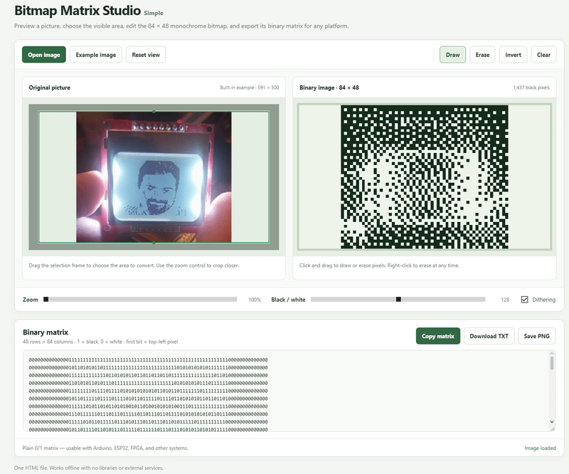

# Nokia 5110 Bitmap Studio

The Nokia 5110 LCD is a small monochrome graphic display originally associated with Nokia mobile phones and now widely used in experimental electronics. Unlike a character-only display, it does not restrict the user to a predefined set of letters or numbers. Its visible surface is a grid of 84 columns and 48 rows, and each of those 4,032 pixels can be controlled individually. A program can therefore draw text, symbols, instrument readings, diagrams, logos, or an entire small photograph reduced to black and white. The display is modest in resolution, but that simplicity makes it useful in projects where a microcontroller or FPGA needs to present information without a video interface, a large framebuffer, or a complicated graphics subsystem. Most Nokia 5110 display modules use the Philips/NXP PCD8544 LCD controller. The controller receives commands and display data over a serial interface and maintains the image in its own display memory. The host sends the contents of that memory; the controller handles the electrical driving of the LCD segments. The image is monochrome rather than grayscale. A pixel is either set or cleared, although the apparent contrast also depends on the LCD's contrast setting, viewing conditions, and the particular module. Some breakout boards include backlighting, but this is a separate hardware feature and does not change the image data.

A complete image occupies only 504 bytes. This figure follows directly from the display geometry: 84 × 48 pixels require 4,032 individual bits, or 504 eight-bit values. The PCD8544 does not organize these bytes as 48 conventional horizontal lines. Instead, its display RAM is divided into six horizontal *pages*, each eight pixels high. Each page contains 84 bytes, one for each column. Within a byte, bit 0 controls the uppermost pixel of that eight-pixel group, bit 1 the pixel below it, and so on through bit 7. Once the 84 bytes of the first page have been written, the next 84 bytes describe rows 8–15, and the process continues until the sixth page covers rows 40–47. This detail matters whenever an image is transferred from a computer into a Nokia 5110 project. A human-readable drawing normally follows conventional row-by-row order, starting at the upper-left corner and proceeding horizontally. The LCD expects the same pixels packed vertically into bytes and arranged by page. Sending an ordinary row-major bitmap directly to the PCD8544 will not reproduce the intended picture. The bitmap must first be converted into the controller's memory layout, and the display itself must be initialized and addressed by the host program before the data can be written.

## What this repository contains

**Nokia 5110 Bitmap Studio** is a standalone browser-based editor for preparing images at the display's native 84 × 48 resolution, and the original project was made in Visual Basic 6.0, wich can be found <a href="https://github.com/Gagniuc/LCD5110-FPGA">here</a>. The application is contained in `Nokia5110_Bitmap_Studio_Simple_Standalone.html`. It runs locally in a modern browser, without installation, a server, or an Internet connection. The interface and its example photograph are embedded in the HTML file; no image-processing service or external JavaScript library is required. The Studio places the original photograph and the resulting LCD image side by side. This is important because a photograph that looks reasonable at its original size may become unrecognizable when reduced to 4,032 black-and-white pixels. The original-image panel retains the photograph rather than showing only its converted pixels. A movable crop frame identifies the part of the photograph that will be used, and the zoom control changes how much of the photograph fits inside that frame. The user can inspect the source and the actual 84 × 48 result together, making it easier to preserve the important outline, face, symbol, or area of interest before exporting the image. Conversion begins by resampling the selected region into the LCD's 84 × 48 grid. The application then calculates a grayscale intensity for each pixel and compares it with an adjustable black-and-white threshold. Pixels below the threshold become black; the others become white. This direct threshold method is useful for strong silhouettes, diagrams, and high-contrast artwork. An optional Floyd–Steinberg dithering mode distributes quantization error to neighboring pixels. Dithering can preserve the visual impression of shading in a photograph, but it does not introduce actual gray levels: the finished image still contains only black and white pixels. The result can be adjusted manually in the pixel editor. Drawing sets individual pixels, erasing clears them, and dragging produces continuous strokes. The editor also supports color inversion and a clear operation. Manual edits are retained while conversion parameters are changed, allowing small corrections to an image after the initial automatic conversion. A built-in sample image is available when the page opens, so the conversion process can be examined before loading a local photograph.

## Image data and the PCD8544 layout

The editor exposes two representations of the same image. The **pixel matrix** is a text document with 48 lines, each containing 84 binary digits. In this representation, `1` means a black pixel and `0` means a white pixel. The first character on the first line describes the upper-left pixel, and every subsequent line represents the next row. This form is straightforward to inspect, modify, compare, or parse in software. It is also useful when an experiment requires direct access to individual pixel coordinates rather than a packed display-memory buffer. The second representation is the **PCD8544 byte layout**, which is intended for software that sends a complete picture to the Nokia 5110 controller. In this format, the Studio packs the same binary pixels into 504 bytes, ordered as six pages of 84 columns. For a pixel at coordinate `(x, y)`, its byte is located at offset `(y / 8) * 84 + x`, using integer division, and its bit position is `y % 8`. For example, the pixel at `(0, 0)` occupies bit 0 of the first byte, while the pixel at `(0, 7)` occupies bit 7 of that same byte. The pixel at `(0, 8)` starts the second page, at byte offset 84. This is the fundamental distinction between a readable two-dimensional binary matrix and the serialized data the PCD8544 expects. The selected representation can be copied from the page or saved as a text file. When the LCD-byte representation is selected, the Studio can also generate a C/C++ header containing a `static const uint8_t nokia5110_bitmap[504]` array, with hexadecimal byte values and comments identifying the six pages. This is a convenient starting point for Arduino, ESP32, and other C/C++-based projects. The header contains the image data, not a complete device driver; the receiving project must still configure the display and send those bytes correctly. On memory-constrained targets, the developer may also need to adapt the array's storage declaration to the compiler and memory architecture being used. A raw `.bin` export contains exactly the 504 packed bytes, without a header, length field, or other metadata. That is useful when the display image is stored as a firmware resource, read from memory, or transferred by a custom routine. A PNG export preserves the final 84 × 48 black-and-white image in an ordinary graphics file, allowing the result to be viewed or archived outside the Studio. These exports describe one image in different forms; they do not change its resolution or add gray levels. Because the underlying data is independent of the processor, it can also be used in FPGA projects or other embedded environments. A Verilog design, for example, can read the textual matrix or consume the packed bytes after they have been placed in a memory initialization structure. The current simplified Studio does **not** generate a ready-made Verilog module, Quartus `.mif` file, or platform-specific display driver. Those can be produced separately from its matrix or binary exports without changing the image itself.

## Using the Studio with a physical display

Open `Nokia5110_Bitmap_Studio_Simple_Standalone.html` in a browser and load a photograph or use the built-in example. Move the crop area over the part of the image to retain, then adjust zoom, threshold, and dithering until the 84 × 48 preview is readable. Individual details can be corrected in the pixel editor before selecting either the text matrix or the LCD-byte output. For a typical microcontroller implementation that sends bytes to the PCD8544, the 504-byte format is the more direct choice. The exported bitmap does not itself illuminate the display or establish communication with it. The host circuit must provide suitable power and logic levels, connect the controller's interface signals, perform the required PCD8544 initialization, and issue the commands and data transfers needed to update display RAM. The controller is commonly connected through signals identified as serial clock, serial data, chip enable, data/command selection, and reset. Exact connector labeling, allowable supply voltage, and backlight circuitry vary between modules and should be checked against the board actually being used. The Studio makes no assumptions about those electrical connections.
